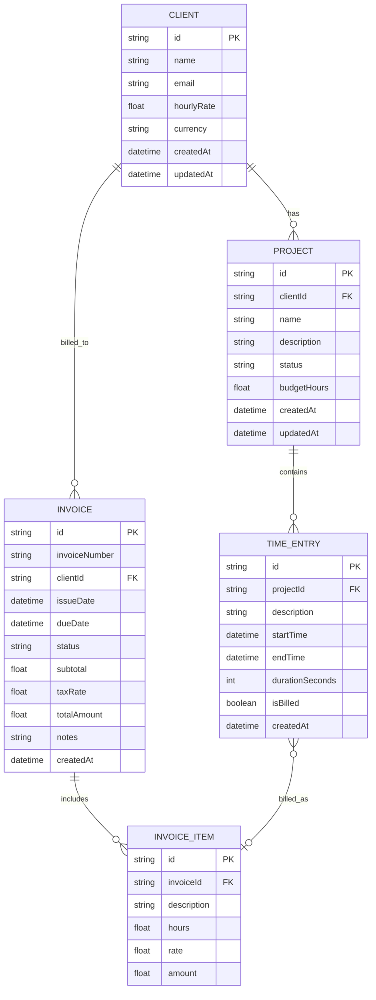
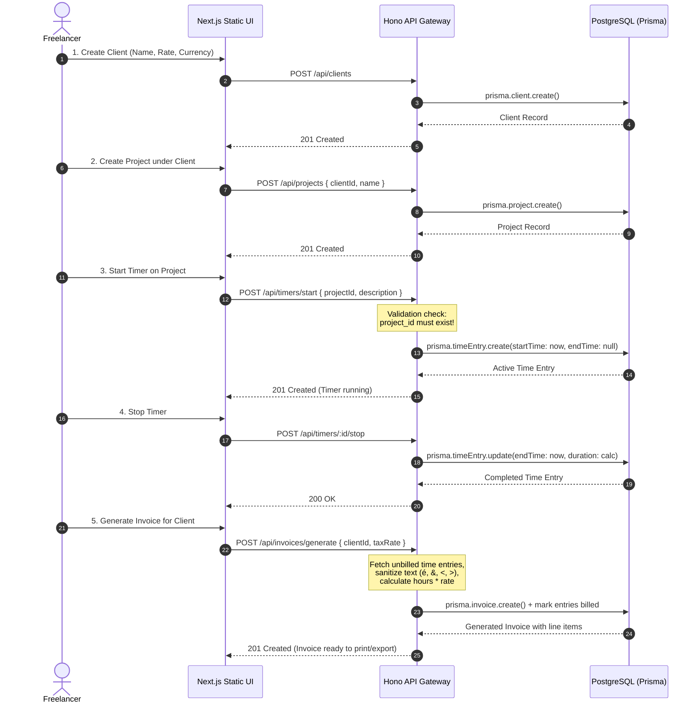

# ClientPilot - Product Brainstorm & Architectural Conception

## 1. Executive Summary & Product Vision
**ClientPilot** is a streamlined, AI-native micro-SaaS engineered for independent freelancers, contractors, and digital consultants. It eliminates fragmented administrative overhead by unifying four core operational pillars:
1. **Client Relationship Management**: Client directory, hourly billing rates, contact metadata, and preferred currency.
2. **Project Portfolio Tracking**: Projects tied to clients with budget allocations, delivery deadlines, and status pipelines.
3. **Frictionless Time Tracking**: Real-time start/stop timer, manual duration logging, billable status toggles, and work descriptions.
4. **Instant Invoice Generation**: Automated aggregation of unbilled tracked time into professional, itemized invoices with tax, currency conversion, and downloadable/printable format.

---

## 2. Target Personas & User Journeys

### Persona A: Alex Vance — Full-Stack Freelance Engineer
* **Profile**: Works with 3-5 concurrent clients on retainer or hourly contracts ($85 - $150/hr).
* **Pain Points**: Switching context frequently, forgetting to log hours, struggling with complex spreadsheets at the end of every month.
* **Key Needs**: One-click timer on the active project, automatic hourly rate propagation, immediate conversion of logged time to client invoices.

### Persona B: Elena Rostova — Brand & UI/UX Designer
* **Profile**: Delivers design sprints for international clients in North America and Europe.
* **Pain Points**: Foreign currency handling, special characters in client company names (e.g. *Société Générale*, *Müller & Söhne*), clunky accounting tools that take 10 minutes per invoice.
* **Key Needs**: Clean, aesthetic interface, seamless support for multilingual and special characters (`é`, `&`, `<`, `>`), instant invoice summaries.

---

## 3. Core Domain Entities & Data Model

---

## 4. Architectural Strategy & Tech Stack Trade-offs

| Component | Selected Solution | Key Trade-offs & Advantages |
| :--- | :--- | :--- |
| **Frontend Framework** | **Next.js (Static Export `output: 'export'`)** | Guarantees zero SSR server overhead, instant edge CDN distribution, rapid client-side routing, and seamless bundling inside a single container. |
| **UI Components** | **Tailwind CSS + shadcn/ui Design Pattern** | Highly responsive, customizable, zero-bloat CSS utility classes with accessible primitives (Dialogs, Tabs, Cards, Badges, Tables). |
| **Backend Framework** | **Hono (TypeScript)** | Extremely lightweight (<15KB bundle), ultrafast route dispatching, type-safe schema validation, runs cleanly on Node.js and Bun with minimal resource footprint. |
| **ORM & Persistence** | **Prisma + PostgreSQL** | Strong typing, declarative migrations, rock-solid relational integrity (Foreign Keys, Cascade Deletes), smooth migration path from in-memory prototyping to production PostgreSQL. |
| **Testing** | **Vitest + Playwright** | Fast unit and integration tests with native ESM/TypeScript support via Vitest; end-to-end browser automation for mission-critical flows via Playwright. |
| **Packaging** | **Single Multi-stage Dockerfile** | Stage 1 builds static frontend (`out/`), Stage 2 bundles Hono backend, Final stage executes unified runtime serving static files at `/` and API at `/api/*`. |
| **Cloud Infrastructure**| **AWS CloudFormation (Free Tier)** | 100% Free-tier eligible: Single VPC, Public Subnet, Security Groups, `t2.micro` EC2 Host running Docker Compose, and `db.t3.micro` RDS PostgreSQL. |

---

## 5. End-to-End Workflow Architecture

---

## 6. Critical Edge Cases & Quality Invariants
1. **Timer Missing Project ID**: Any request to start a timer lacking a valid `projectId` must strictly respond with `422 Unprocessable Entity` and a descriptive payload, rather than crashing with an unhandled `500`.
2. **Special Character Invariant**: Client names or project notes containing Unicode diacritics or HTML/XML entities (`Société & Co <Paris>`, `Müller & Söhne`) must be sanitized against XSS while preserving legitimate characters in generated invoices.
3. **Billable Time Deduplication**: Once a time entry is attached to an invoice, its `isBilled` state must atomically toggle to `true` to prevent double-invoicing.
